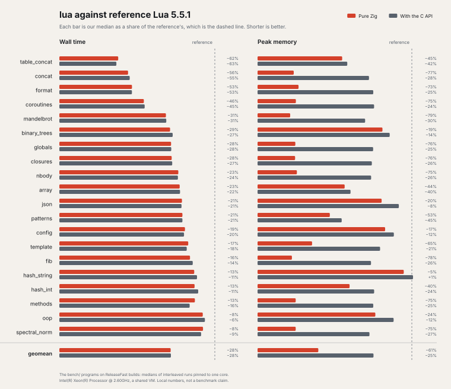

# lua

Lua 5.5 in Zig, with no C.

This project is incubating. It is unstable, its API will change, and it is not ready to depend on.

<picture>
  <source media="(prefers-color-scheme: dark)" srcset="docs/static/benchmark-dark.svg">
  
</picture>

The pure Zig build is static and links no libc, so it cannot load C modules (`.so` files). The build with the C API (`-Dc-api=true`) links glibc to load them with `dlopen`, and glibc and its loader add about 1.3 MiB to every process: that floor is most of its memory gap on the small programs.

`just optimize="ReleaseFast ReleaseFast-capi" bench-compare` takes these numbers, and `just bench-plot` draws them; `bench/README.md` has the programs and the method.

## Embed it

A Zig program hosts Lua through `lua.State`, and extends it with Zig functions and Zig types:

```zig
const lua = @import("lua");

fn add(a: i64, b: i64) i64 {
    return a + b;
}

const state = try lua.State.init(gpa, .{});
defer state.close();
try state.setGlobal("add", add);
const sum = try state.doString(i64, "return add(1, 2)", .{});
```

`docs/embedding.md` is the guide, and `examples/host/main.zig` a complete host that uses Lua for configuration and plugins (`zig build example`).

## Work on it

`nix develop` provides the toolchain, and `just ci` runs what CI runs.

## License

MIT. See `LICENSE`. The vendored Lua 5.5.1 test suite is PUC-Rio's; see `THIRD_PARTY.md`.
